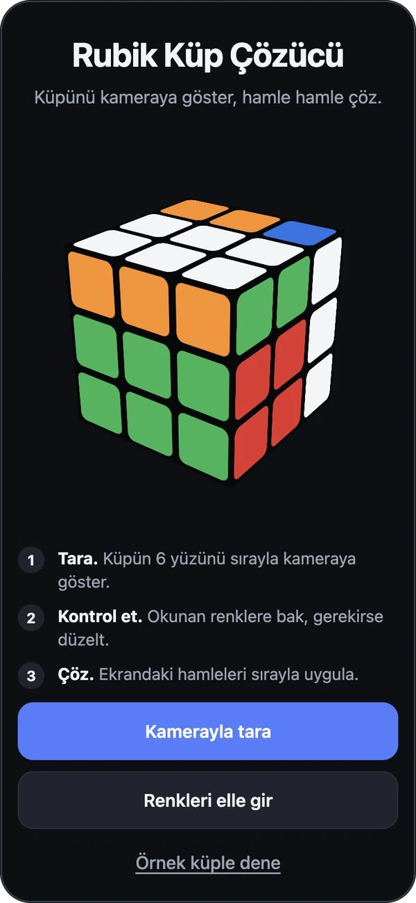
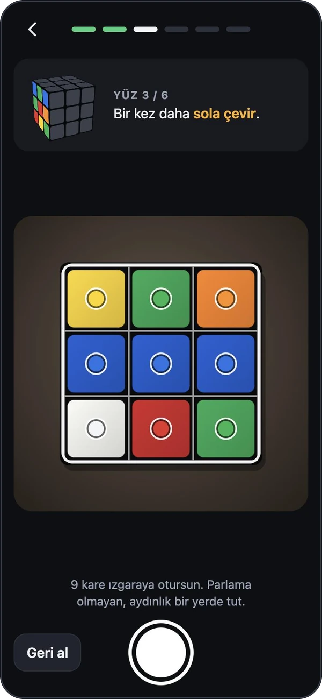
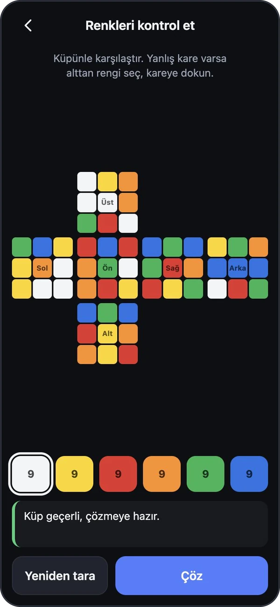
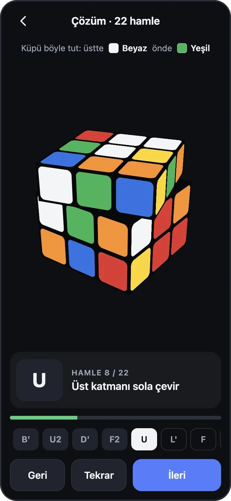

<div align="center">


# Rubik Küp Çözücü

**Küpünü telefon kamerasına göster, hamle hamle çöz.**

Kurulum yok: tarayıcıda açılır, kamera görüntüsü telefonundan çıkmaz.

<a href="https://ozdmrysn.github.io/rubic/"></a>

Telefonundan aç: **[ozdmrysn.github.io/rubic](https://ozdmrysn.github.io/rubic/)**

</div>

<br>

<table>
  <tr>
    <td align="center" width="25%">
      <a href="https://ozdmrysn.github.io/rubic/"></a>
    </td>
    <td align="center" width="25%">
      <a href="https://ozdmrysn.github.io/rubic/"></a>
    </td>
    <td align="center" width="25%">
      <a href="https://ozdmrysn.github.io/rubic/"></a>
    </td>
    <td align="center" width="25%">
      <a href="https://ozdmrysn.github.io/rubic/"></a>
    </td>
  </tr>
  <tr>
    <td align="center"><b>Başla</b><br><sub>Kamerayla tara, elle gir ya da örnek küple dene</sub></td>
    <td align="center"><b>1 · Tara</b><br><sub>6 yüzü sırayla ızgaraya oturt; küçük küp nasıl çevireceğini gösterir</sub></td>
    <td align="center"><b>2 · Kontrol et</b><br><sub>Okunan renkleri küpünle karşılaştır, yanlış kareyi dokunarak düzelt</sub></td>
    <td align="center"><b>3 · Çöz</b><br><sub>3B küp her hamleyi oynatır; sen de aynısını yap</sub></td>
  </tr>
</table>

## Nasıl kullanılır

1. **[Uygulamayı aç](https://ozdmrysn.github.io/rubic/)** ve "Kamerayla tara"ya basıp kamera iznini ver.
2. **Tara.** Küpün bir yüzünü ızgaraya oturt, çek. Sonraki yüzler için küpü ekrandaki küçük küp gibi çevir:
   üç kez sola, sonra öne yatır, sonra yarım tur.
3. **Kontrol et.** Renkler açılmış küp olarak gelir. Yanlış kare varsa alttan rengi seç, kareye dokun.
4. **Çöz.** Küpü ekranda yazdığı gibi tut (örneğin üstte beyaz, önde yeşil) ve "İleri"ye bastıkça
   gösterilen hamleyi uygula.

> **İpucu:** Aydınlık ama parlama olmayan bir yerde tara ve küpü yalnızca ekranda gösterildiği gibi çevir.

## Özellikler

- **Kamerayla tarama.** 9 karenin rengi canlı okunur; okunan renk her karenin üzerinde görünür.
- **Işığa dayanıklı renk ayırma.** Kareler tek tek tahmin edilmez; orta kareler referans alınıp her renkten
  tam 9 tane olacak şekilde gruplanır. Kırmızı/turuncu ve beyaz/sarı karışıklığı böylece azalır.
- **Otomatik hata düzeltme.** Bir yüz yanlış yöne çevrilmişse ya da bir-iki kare yanlış okunmuşsa ve tek bir
  geçerli düzeltme varsa uygulama kendisi düzeltir, neyi değiştirdiğini de gösterir.
- **Kısa çözümler.** Kociemba'nın iki aşamalı algoritmasıyla genelde 20–22 hamle.
- **3B küp.** Her hamle animasyonla oynar; küpü parmağınla çevirip her yönden bakabilirsin.
  Geri al, tekrar oynat ya da listeden istediğin hamleye atla.
- **Kamera şart değil.** Renkleri elle girebilir ya da örnek küple akışı deneyebilirsin.
- **Her şey cihazda.** Sunucu yok, hesap yok; görüntü hiçbir yere gönderilmez.

## Nasıl çalışır

| Dosya | Görevi |
| --- | --- |
| [`js/scanner.js`](js/scanner.js) | Kamerayı açar, ızgaradaki her karenin ortasından ortanca rengi okur |
| [`js/color.js`](js/color.js) | Renkleri Lab uzayında, orta karelere göre dengeli atamayla 6 gruba ayırır |
| [`js/cube.js`](js/cube.js) | Küp modeli: 54 kare, hamleler, tarama sırası, geçerlilik denetimi |
| [`js/repair.js`](js/repair.js) | Geçersiz taramalarda yüz yönü ve kare rengi düzeltmelerini arar |
| [`js/solver-worker.js`](js/solver-worker.js) | Çözümü arka planda hesaplar ([cubejs](https://github.com/ldez/cubejs)) |
| [`js/cube3d.js`](js/cube3d.js) | CSS 3B dönüşümleriyle çizilen, animasyonlu küp |
| [`js/app.js`](js/app.js) | Ekran akışı: tarama → kontrol → çözüm |

Derleme adımı ve bağımlılık kurulumu yoktur; düz HTML, CSS ve JavaScript modülleridir.

## Geliştirme

```bash
python3 -m http.server 8123   # http://localhost:8123
```

```bash
node test/model.test.mjs      # küp modeli, tarama ve çözücü testleri
```

Kamerasız tarama testi için tarayıcı konsolunda:

```js
await import('./test/fakecam.js'); await __runScan()
```

## Teşekkür

Çözücü, Petri Lehtinen ve Ludovic Fernandez'in MIT lisanslı [cubejs](https://github.com/ldez/cubejs)
kütüphanesini kullanır ([lisans](vendor/cubejs/LICENSE)).
